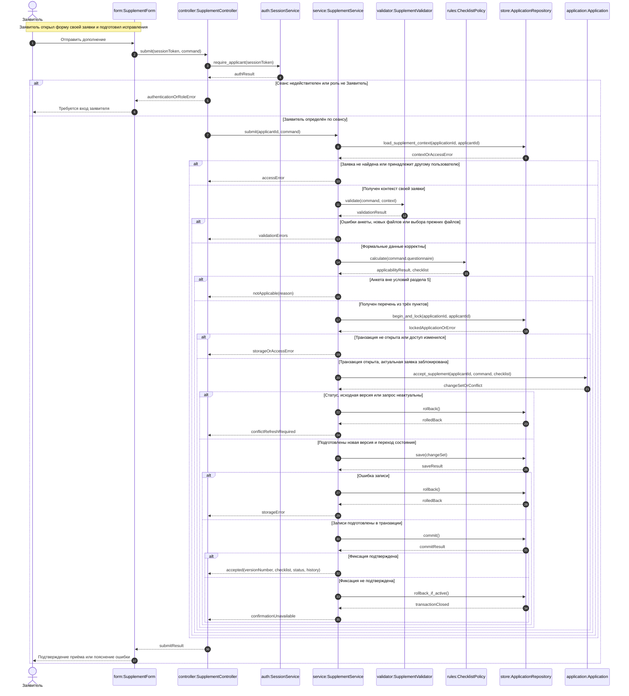

# Лабораторная работа № 4. Диаграмма последовательностей на уровне классов

## Выбранный прецедент

**«Дополнить заявку по запросу специалиста»** из [lab01](use_case.md). Диаграмма раскрывает отправку дополнения из [системной последовательности lab03](system_sequence.md) через взаимодействия объектов приложения. Открытие формы — предусловие: заявитель уже получил исходную версию, перечень, файлы и запрос с замечаниями. Проверка специалистом начинается после этого сценария и здесь не выполняется.

Цель — принять новую неизменяемую версию заявки и вернуть её на проверку. Получение сертификата, фотографий и ИНН происходит вне приложения; выдача патента не входит в тему. Авторизация при отправке проверяется повторно, поскольку сеанс мог истечь после открытия формы.

## Объекты и ответственность

Обозначение `имя:Класс` указывает конкретный объект класса. Заявитель — внешний актор, остальные линии — объекты приложения. Сплошная стрелка означает вызов метода, пунктирная — возврат результата; `alt/else` показывает взаимоисключающие ветви. Возвращаемые ошибки — результаты операций, а не самостоятельные сообщения пользователя.

| Объект | Ответственность |
| --- | --- |
| `form:SupplementForm` | Собирает исправленную анкету и вложения, вызывает контроллер и показывает результат. Не определяет права и не меняет статус заявки самостоятельно. |
| `controller:SupplementController` | Принимает команду, получает личность заявителя из сеанса, вызывает прикладной сервис и преобразует результат в ответ форме. |
| `auth:SessionService` | Проверяет действительность сеанса и роль «Заявитель». Идентификатор пользователя не принимается на доверии из формы. |
| `service:SupplementService` | Координирует чтение, формальную проверку, расчёт перечня, доменную операцию и транзакцию сохранения. |
| `validator:SupplementValidator` | Проверяет обязательные поля, значения, номер ИНН при заявленном наличии, форматы и размеры новых файлов; проверяет принадлежность выбранных прежних файлов исходной версии этой заявки. |
| `rules:ChecklistPolicy` | Проверяет применимость учебных условий раздела 5 и рассчитывает три пункта 5.1–5.3 по исправленной анкете. |
| `store:ApplicationRepository` | Читает данные с ограничением по владельцу, блокирует актуальную заявку и сохраняет изменения в одной транзакции БД. Методы `begin_and_lock`, `save`, `commit` и откат относятся к одной операции сервиса и одному соединению. |
| `application:Application` | Доменный объект актуальной заявки, возвращённый репозиторием после блокировки. Проверяет допустимость дополнения и формирует согласованный набор изменений `changeSet`. |

Это проектное распределение ответственности; язык, фреймворк и СУБД пока не выбраны. Классы политик, формы и сервисов не являются новыми бизнес-сущностями ER-модели. Репозиторий представляет доступ к БД, поэтому отдельная линия БД для показа взаимодействия объектов не нужна.

## Данные и порядок вызовов

`command` содержит идентификаторы заявки, исходной версии и запроса, исправленную анкету, новые файлы с кодами пунктов перечня и идентификаторы выбранных прежних файлов. `applicantId` берётся из проверенного сеанса. `context` содержит исходную версию и метаданные её документов для проверки команды; это снимок для предварительных проверок, а не гарантия актуальности при сохранении.

1. Контроллер проверяет сеанс и роль. Репозиторий возвращает контекст только для собственной заявки заявителя; отказ не раскрывает данные чужого обращения.
2. Валидатор проверяет формальную корректность команды. Отсутствие ещё не полученного документа само по себе не является ошибкой: комплектность оценивает специалист. Файлы исходной версии неизменяемы, поэтому результат проверки их принадлежности сохраняет смысл до записи.
3. Политика применяет условия учебной модели: гражданство Азербайджана, Таджикистана, Узбекистана, Молдовы или Украины при отсутствии обоих особых статусов. Для 5.1 определяется получение сертификата либо использование имеющегося подтверждения знаний; для 5.2 — фото 3 × 4 см; для 5.3 — получение ИНН либо указание имеющегося номера. Отдельный файл ИНН не обязателен. Неприменимость возвращается с причиной без записи новой версии.
4. `begin_and_lock` открывает транзакцию, повторно проверяет владельца и загружает актуальный объект заявки с блокировкой. При ошибке открытия или чтения репозиторий сам закрывает начатую транзакцию перед возвратом ошибки.
5. `accept_supplement` проверяет владельца, состояние «Требует дополнения», совпадение исходной версии с последней и принадлежность запроса проверке этой версии. Запрос ещё не должен иметь принятого ответа. При конфликте набор изменений не создаётся, сервис откатывает транзакцию и предлагает обновить заявку.
6. При успехе доменный объект формирует следующую версию с анкетой, тремя пунктами перечня, новыми и выбранными прежними файлами, ссылкой на запрос; переводит заявку в «Подана» и добавляет событие «Требует дополнения → Подана» с очередным номером, датой и инициатором. До фиксации эти изменения существуют только внутри операции.
7. Репозиторий записывает весь набор и фиксирует транзакцию. Сервис возвращает подтверждение только после подтверждённого `commit`. Контроллер передаёт результат форме, которая показывает номер версии, перечень, статус и историю либо причину отказа.

## Целостность и альтернативы

Одна блокировка заявки охватывает повторную проверку актуальности и все записи. Все операции, меняющие заявку, должны соблюдать тот же порядок блокировки. Уникальные ограничения на `(application_id, version_number)` и ненулевой `response_to_request_id` дополнительно исключают две версии с одним номером и два ответа на запрос. Это конкретизация ограничений [ER-модели lab02](er.md), а не новое требование курса.

`save(changeSet)` сохраняет `APPLICATION_VERSION`, три `CHECKLIST_ITEM`, содержимое и метаданные `DOCUMENT`, обновление `APPLICATION` и новый `STATUS_EVENT`. Прежние версии и документы не меняются; выбранные прежние файлы копируются в состав новой версии. Запрос получает ответ через ссылку новой версии `response_to_request_id`. Новая проверка `REVIEW`, оценки и заключение здесь не создаются.

Ошибки до открытия транзакции не меняют БД. При конфликте или ошибке записи открытая транзакция откатывается целиком. Повторная отправка после успешного приёма отклоняется: заявка уже имеет статус «Подана», а запрос — ответную версию.

Если результат `commit` неизвестен из-за потери соединения, нельзя утверждать, что дополнение не принято: БД могла уже зафиксировать его целиком. `rollback_if_active` освобождает оставшуюся активную транзакцию, но не отменяет подтверждённую БД фиксацию. Форма сообщает об отсутствии подтверждения и предлагает заново открыть заявку для проверки версии и истории, как предусмотрено lab03. Частично сохранённый комплект недопустим при любом исходе.

## Основания

Формат lab04 — `class_sequence.md`, ровно один блок `sequenceDiagram`, один явно названный юзкейс и пояснения — установлен [README преподавателя](https://github.com/ekabardinsky/pis_2026_10/blob/master/README.md) и [labs.json](https://github.com/ekabardinsky/pis_2026_10/blob/master/labs.json), повторно прочитанными 26.10.2026. Объекты и методы — решения учебного проекта на основе lab01–lab03. Диаграмма классов lab05 и реализация приложения в эту работу не входят.

Срок исполнения — вычисляемое значение `dueAt`: дата первоначальной подачи плюс 3 календарных дня. Оно доступно обеим ролям; дополнение не переносит срок. Длительность — условие учебной реализации, а не нормативный срок; требование показывать сроки сообщено пользователем по заметке со встречи с преподавателем.
