# Лабораторная работа № 5. Диаграмма классов приложения

```mermaid
classDiagram
    direction TB
    class User {
        -UUID userId
        -String phone
        -Role role
        -DateTime registeredAt
    }
    class SessionService {
        +register(phone, code) AuthResult
        +login(phone, code) AuthResult
        +requireApplicant(sessionToken) AuthResult
        +requireSpecialist(sessionToken) AuthResult
    }
    class Session {
        -String tokenHash
        -DateTime expiresAt
        +isValid(now) Boolean
    }
    class Application {
        -UUID applicationId
        -ApplicationStatus currentStatus
        -DateTime submittedAt
        +submit(applicantId, command, checklist) ChangeSet
        +acceptSupplement(applicantId, command, checklist) ChangeSet
        +startReview(specialistId) ChangeSet
        +saveAssessment(specialistId, findings) ChangeSet
        +requestSupplement(specialistId, instructions) ChangeSet
        +complete(specialistId, conclusionText) ChangeSet
    }
    class ApplicationVersion {
        -UUID versionId
        -Integer versionNumber
        -DateTime submittedAt
    }
    class Questionnaire {
        -String citizenship
        -Boolean isHighlyQualified
        -Boolean isResettlementParticipant
        -Boolean hasLanguageDocument
        -Boolean hasInn
        -String inn
    }
    class ChecklistItem {
        -UUID itemId
        -String code
        -String requiredAction
        -String basis
    }
    class Document {
        -UUID documentId
        -String documentKind
        -String fileName
        -String mediaType
        -Bytes fileContent
        -DateTime attachedAt
    }
    class Review {
        -UUID reviewId
        -ReviewState state
        -DateTime startedAt
        -DateTime assessedAt
        +assess(findings) ValidationResult
        +canRequestSupplement() Boolean
        +canComplete() Boolean
    }
    class Finding {
        -UUID findingId
        -Assessment assessment
        -String comment
    }
    class SupplementRequest {
        -UUID requestId
        -String instructions
        -DateTime requestedAt
    }
    class Conclusion {
        -UUID conclusionId
        -String conclusionText
        -DateTime issuedAt
    }
    class StatusEvent {
        -UUID eventId
        -Integer eventNumber
        -ApplicationStatus previousStatus
        -ApplicationStatus newStatus
        -DateTime occurredAt
        -String comment
    }
    class SupplementForm {
        -SupplementCommand command
        +submit(sessionToken, command) SubmitResult
        +showResult(result) void
    }
    class SupplementController {
        +submit(sessionToken, command) SubmitResult
    }
    class SupplementService {
        +submit(applicantId, command) SubmitResult
    }
    class SupplementValidator {
        +validate(command, context) ValidationResult
    }
    class ChecklistPolicy {
        +calculate(questionnaire) ApplicabilityResult
    }
    class SupplementCommand {
        +UUID applicationId
        +UUID sourceVersionId
        +UUID requestId
        +Questionnaire questionnaire
        +UUID[] selectedDocumentIds
        +NewDocument[] newDocuments
    }
    class NewDocument {
        +String checklistCode
        +String documentKind
        +String fileName
        +String mediaType
        +Bytes fileContent
    }
    class SupplementContext {
        +UUID applicationId
        +UUID applicantId
        +ApplicationVersion sourceVersion
    }
    class ChangeSet {
        +Application application
        +ApplicationVersion newVersion
        +Review changedReview
        +StatusEvent newEvent
    }
    class ApplicationRepository {
        +loadSupplementContext(applicationId, applicantId) ContextResult
        +beginAndLock(applicationId, applicantId) LockResult
        +beginAndLockForReview(applicationId, specialistId) LockResult
        +save(changeSet) SaveResult
        +commit() CommitResult
        +rollback() void
        +rollbackIfActive() void
    }
    class SubmissionService {
        +submit(applicantId, command) SubmitResult
    }
    class ReviewService {
        +start(specialistId, applicationId) ReviewResult
        +saveAssessment(specialistId, applicationId, findings) ReviewResult
        +requestSupplement(specialistId, applicationId, instructions) ReviewResult
        +complete(specialistId, applicationId, conclusionText) ReviewResult
    }
    class ApplicationQueryService {
        +getOwnApplication(applicantId, applicationId) ApplicationView
        +listCompleted(applicantId) ApplicationView[]
        +listPending(specialistId) ApplicationView[]
    }
    class Role {
        <<enumeration>>
        APPLICANT
        SPECIALIST
    }
    class ApplicationStatus {
        <<enumeration>>
        SUBMITTED
        UNDER_REVIEW
        NEEDS_SUPPLEMENT
        COMPLETED
    }
    class ReviewState {
        <<enumeration>>
        OPEN
        ASSESSED
        SUPPLEMENT_REQUESTED
        COMPLETED
    }
    class Assessment {
        <<enumeration>>
        CONFORMS
        NEEDS_CORRECTION
    }

    User "1" -- "0..*" Session : authenticated by
    User "1" -- "0..*" Application : owns
    User "1" -- "0..*" Review : performs
    User "1" -- "0..*" StatusEvent : initiates
    Application "1" *-- "1..*" ApplicationVersion : versions
    Application "1" *-- "1..*" StatusEvent : history
    ApplicationVersion "1" *-- "1" Questionnaire : snapshot
    ApplicationVersion "1" *-- "3" ChecklistItem : checklist
    ApplicationVersion "1" *-- "0..*" Document : attachments
    ChecklistItem "1" -- "0..*" Document : supported by
    ApplicationVersion "1" *-- "0..*" Review : checks
    Review "1" *-- "0..3" Finding : assessments
    ChecklistItem "1" -- "0..*" Finding : assessed item
    Review "1" *-- "0..1" SupplementRequest : correction decision
    Review "1" *-- "0..1" Conclusion : positive decision
    SupplementRequest "0..1" -- "0..1" ApplicationVersion : answered by
    SessionService ..> User
    SessionService ..> Session
    SupplementForm ..> SupplementController : submit
    SupplementForm ..> SupplementCommand
    SupplementController ..> SessionService : requireApplicant
    SupplementController ..> SupplementService : submit
    SupplementService ..> ApplicationRepository
    SupplementService ..> SupplementValidator
    SupplementService ..> ChecklistPolicy
    SupplementService ..> Application : acceptSupplement
    SupplementService ..> SupplementCommand
    SupplementValidator ..> SupplementContext
    SupplementValidator ..> SupplementCommand
    ChecklistPolicy ..> Questionnaire
    ChecklistPolicy ..> ChecklistItem : calculates
    ApplicationRepository ..> Application : loads with lock
    ApplicationRepository ..> SupplementContext : loads
    ApplicationRepository ..> ChangeSet : saves
    Application ..> ChangeSet : prepares
    Application ..> Review : checks decision
    SupplementCommand ..> NewDocument
    SubmissionService ..> SupplementValidator
    SubmissionService ..> ChecklistPolicy
    SubmissionService ..> ApplicationRepository
    SubmissionService ..> Application : submit
    ReviewService ..> ApplicationRepository
    ReviewService ..> Application : review operations
    ApplicationQueryService ..> ApplicationRepository : reads
    User ..> Role
    Application ..> ApplicationStatus
    StatusEvent ..> ApplicationStatus
    Review ..> ReviewState
    Finding ..> Assessment
```

## Границы и нотация

Диаграмма описывает классы приложения подготовки документов для патента по пунктам 5.1–5.3. Она охватывает вход, подачу, дополнение, проверку, заключение и чтение истории. Заявитель и специалист — значения роли пользователя; наследование классов пользователей не требуется. Экзамен, фотографии, получение ИНН и выдача патента выполняются вне сервиса.

`+` означает публичный член, `-` — закрытое поле. Сплошная линия — ассоциация, ромб у владельца — композиция, пунктирная стрелка — зависимость использования. Кратности стоят у соответствующих концов связей. Композиция задаёт принадлежность объектов, но не разрешает физическое удаление архивной истории. Зависимость не означает владение объектом. Идентификаторы UUID и типы логические: язык, фреймворк и СУБД ещё не выбраны.

В связях выражены ссылки на владельца, версию, пункт и специалиста; их внешние ключи повторно не перечислены как поля. `Questionnaire` — объект значения внутри версии, сохраняемый в полях `APPLICATION_VERSION` из [ER-модели](er.md), а не новая самостоятельная таблица. Остальные десять предметных классов соответствуют десяти сущностям ER-модели. Форма, контроллеры, сервисы, команды и результаты не являются дополнительными предметными таблицами.

## Ответственность классов

| Группа | Назначение |
| --- | --- |
| `User`, `Session`, `SessionService` | Пользователь с одной ролью, действующий сеанс и регистрация/вход по телефону с SMS-кодом. Публичная регистрация создаёт только заявителя; специалист заведён заранее. Допустим учебный код `123456`. Проверка сеанса возвращает идентификатор и роль, а не доверяет данным формы. Технические сеансы также сохраняются в БД. |
| `Application` | Корень согласованных изменений заявки: проверяет владельца, статус, актуальную версию и допустимость решения. Создаёт набор изменений, но самостоятельно не выполняет запросы к БД. |
| `ApplicationVersion`, `Questionnaire`, `ChecklistItem`, `Document` | Неизменяемая принятая версия анкеты, три пункта перечня и файлы. При дополнении выбранные старые файлы копируются в новую версию с новыми идентификаторами и привязкой к её пунктам. |
| `Review`, `Finding`, `SupplementRequest`, `Conclusion` | Проверка одной версии одним специалистом, оценки её пунктов и один из двух возможных исходов. `Review` проверяет полноту и содержание оценок; `Application` дополнительно проверяет состояние всей заявки. |
| `StatusEvent` | Неизменяемый переход состояния с порядковым номером, датой, инициатором и комментарием. |
| `SupplementForm`, `SupplementController` | Форма собирает команду и показывает ответ. Контроллер проверяет сеанс через `requireApplicant` и передаёт сервису установленного заявителя. |
| `SupplementService`, `SupplementValidator`, `ChecklistPolicy` | Координация дополнения, формальная проверка данных и расчёт применимости/перечня. Отсутствие документа допускается; оценка комплектности относится к специалисту. |
| `ApplicationRepository` | Чтение из БД, проверка доступа при загрузке, блокировка и атомарная запись набора изменений. Один экземпляр на операцию использует одну транзакцию и соединение. |
| `SubmissionService`, `ReviewService`, `ApplicationQueryService` | Первичная подача; действия специалиста; чтение своих заявок, перечня, истории, результата и завершённых услуг, а также очереди специалиста. |

Для читаемости подробно показаны форма и контроллер прецедента lab04; остальные экранные формы и контроллеры однотипны и опущены. Их входные точки обязаны проверять сеанс и нужную роль через `SessionService` перед вызовом сервисов. Запросы чтения ограничиваются владельцем либо полномочиями специалиста; роль проверяется также на границе прикладной операции.

## Контракты и соответствие lab04

Имена всех восьми классов объектов [внутренней последовательности](class_sequence.md) и вызываемых там методов сохранены, включая `requireApplicant`, `loadSupplementContext`, `validate`, `calculate`, `beginAndLock`, `acceptSupplement`, `save`, `commit`, `rollback`, `rollbackIfActive`. `beginAndLock` возвращает актуальный `Application`; `loadSupplementContext` — снимок исходной версии с документами для предварительной проверки.

`SupplementCommand` содержит те же данные, что `command` в lab04: заявку, исходную версию, запрос, исправленную анкету, выбранные прежние файлы и новые вложения с кодами пунктов. `NewDocument` — входные байты и метаданные, а `Document` — принятый неизменяемый файл с идентификатором и датой. Отправитель не может задавать владельца заявки через команду.

Обозначения типов результатов сокращают диаграмму; это контракты возвращаемых значений, а не дополнительные сущности:

- `AuthResult` — проверенный пользователь/сеанс либо ошибка входа или роли.
- `ValidationResult` — успех либо ошибки полей, форматов, размера и принадлежности выбранных файлов исходной версии.
- `ApplicabilityResult` — применимость, причина отказа либо перечень из трёх пунктов.
- `ContextResult`, `LockResult` — контекст/заблокированная заявка либо отказ доступа или ошибка хранилища.
- `SaveResult`, `CommitResult` — исход записи/фиксации; commit может иметь неизвестный исход при потере соединения.
- `SubmitResult`, `ReviewResult` — подтверждённый результат операции либо объяснение отказа; `ApplicationView` — данные разрешённого просмотра.

`ChangeSet` содержит изменённую заявку и только созданные или изменённые части: новую версию с перечнем/файлами, проверку с оценками и решением, событие истории. Необязательные части отсутствуют у операций, которым они не нужны; сохранение оценки без решения не создаёт события перехода. Успешная операция дополнения содержит новую версию и событие, но не новую проверку. Набор изменений сохраняется целиком до единого commit.

Первичная подача использует те же формальные правила и политику; `validate(command, context)` принимает пустой контекст для первичной команды без выбора прежних файлов. `Application.submit` — фабричная операция создания новой заявки, первой версии и события. Репозиторий при сохранении нового набора открывает транзакцию, если она ещё не открыта; для изменений существующей заявки сервис предварительно вызывает соответствующий метод блокировки. `ApplicationQueryService` использует операции чтения репозитория; их однотипные сигнатуры, детали доступа к БД и отображения опущены.

## Роли, состояния и ограничения

| Перечисление | Значения предметной модели |
| --- | --- |
| `Role` | `APPLICANT` — Заявитель; `SPECIALIST` — Специалист по проверке комплекта |
| `ApplicationStatus` | `SUBMITTED` — Подана; `UNDER_REVIEW` — На проверке; `NEEDS_SUPPLEMENT` — Требует дополнения; `COMPLETED` — Завершена |
| `ReviewState` | `OPEN` — Открыта; `ASSESSED` — Оценка сохранена; `SUPPLEMENT_REQUESTED` — Запрошено дополнение; `COMPLETED` — Завершена |
| `Assessment` | `CONFORMS` — Соответствует; `NEEDS_CORRECTION` — Требует исправления |

Допустимы только переходы: подача → «Подана», начало проверки → «На проверке», запрос → «Требует дополнения», принятый ответ → «Подана», заключение → «Завершена». Сохранение оценки без решения оставляет «На проверке». Переход, событие и связанная версия или решение сохраняются атомарно. Текущий статус соответствует последнему событию.

1. У версии ровно три пункта 5.1–5.3; неприменимая анкета не создаёт принятую версию. Условия гражданства и двух особых статусов, получение/использование документа о знаниях, фото 3 × 4 см и наличие/получение ИНН сохраняются из lab01–lab04. Это учебные условия задания.
2. Каждый документ относится к пункту своей версии; каждая оценка — к пункту версии своей проверки. ИНН хранится в анкете и обязателен при `hasInn=true`; отдельный файл ИНН не обязателен.
3. Заявкой владеет заявитель, проверку выполняет специалист. На заявку допускается не более одной открытой проверки; работа ведётся только с последней версией. До решения у проверки может быть 0–3 оценки, перед решением — ровно три, по одной на каждый пункт.
4. Запрос и заключение одной проверки взаимоисключающие. Запрос требует хотя бы одного недостатка и инструкций; заключение — соответствия всех пунктов. На всю заявку допускается только одно заключение. Закрытые проверки и принятые версии не перезаписываются.
5. Первая версия не отвечает на запрос. Каждое дополнение отвечает ровно на один запрос проверки непосредственно предыдущей версии этой же заявки. У запроса не больше одного принятого ответа; изображённая связь `0..1 — 0..1` не выражает эти дополнительные условия сама по себе.
6. `acceptSupplement` требует владельца, статус «Требует дополнения», совпадение исходной версии с последней и отсутствие ответа на запрос. Репозиторий проверяет доступ и держит блокировку до завершения транзакции. Все изменяющие операции используют одинаковую блокировку заявки; уникальны номер версии внутри заявки, ненулевая ссылка на запрос и номер события внутри заявки.
7. Ошибка до фиксации откатывает открытую транзакцию. При неизвестном исходе commit нельзя обещать отсутствие записи: `rollbackIfActive` закрывает только оставшуюся транзакцию. Пользователь открывает заявку повторно и проверяет принятую версию. Частичное сохранение недопустимо.

## Основания

Формат lab05 — `classes.md`, один блок `classDiagram` с пояснениями — подтверждён по [README преподавателя](https://github.com/ekabardinsky/pis_2026_10/blob/master/README.md) и [labs.json](https://github.com/ekabardinsky/pis_2026_10/blob/master/labs.json) 27.10.2026. Классы и распределение ответственности — решения учебного проекта, согласованные с [прецедентами](use_case.md), [ER-моделью](er.md), [системной последовательностью](system_sequence.md) и [последовательностью классов](class_sequence.md). Эта работа фиксирует проект приложения; выбор стека и реализация относятся к lab06.
