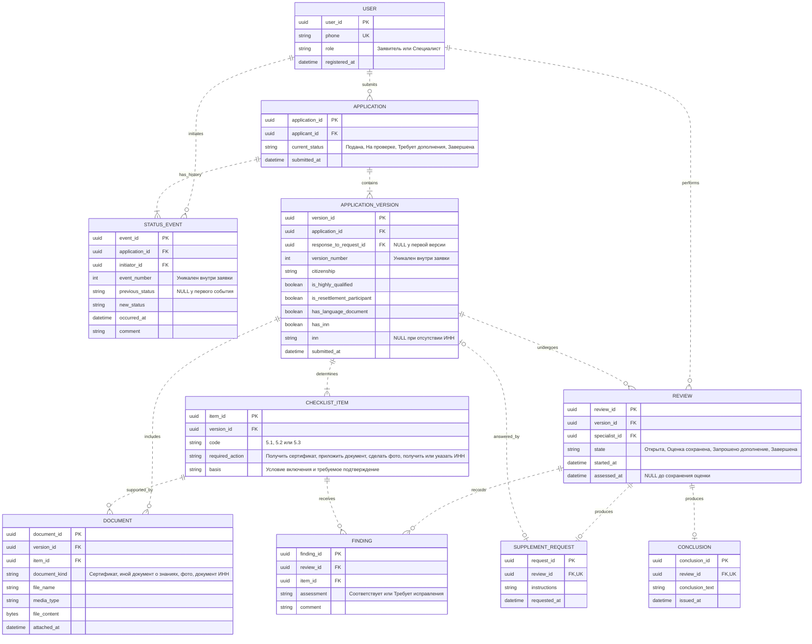

# Лабораторная работа № 2. ER-диаграмма предметной области

## Границы модели

Модель описывает сервис подготовки комплекта документов для патента по пунктам 5.1–5.3 задания: подтверждение знаний русского языка, истории и законодательства, цветные фотографии 3 × 4 см и ИНН. Роли, операции и состояния согласованы с [диаграммой прецедентов](use_case.md). Экзамен, изготовление фотографий, получение ИНН и выдача патента происходят вне сервиса. Результат услуги — заключение специалиста о комплектности, а не патент.

Показаны сущности предметной области, их атрибуты и связи. `PK` — первичный ключ, `FK` — внешний, `UK` — уникальное значение. Типы логические, конкретная СУБД пока не выбрана. Английские идентификаторы используются в диаграмме, русские названия и смысл приведены ниже. Это проектная модель команды, а не дополнительные требования преподавателя.

## Сущности и атрибуты

| Сущность | Назначение |
| ..- | ..- |
| `USER` — пользователь | Учётная запись с уникальным телефоном и одной из двух ролей: «Заявитель», «Специалист». Роль ограничивает операции, но отдельной бизнес-сущностью в этой модели не является. Специалист создаётся заранее; публичная регистрация создаёт заявителя. |
| `APPLICATION` — заявка | Обращение одного заявителя, дата первоначальной подачи и текущее состояние. Один заявитель может подать несколько независимых заявок. |
| `APPLICATION_VERSION` — версия заявки | Неизменяемый снимок принятой анкеты при первой подаче или дополнении. Хранит гражданство, два признака льготных статусов, наличие документа о знаниях и ИНН. Исправления создают следующую версию, а не заменяют старые сведения. |
| `CHECKLIST_ITEM` — пункт индивидуального перечня | Требование по одному из пунктов 5.1–5.3, рассчитанное для конкретной версии анкеты: действие и основание. Уникальна пара `(version_id, code)`. Хранение результата расчёта позволяет восстановить перечень, использованный специалистом. |
| `DOCUMENT` — приложенный документ | Один файл, подтверждающий один пункт перечня одной версии. Несколько файлов могут относиться к одному пункту. Содержимое и метаданные сохраняются в БД. Файл предыдущей версии остаётся доступен; повторно используемые приложения копируются в состав новой версии. |
| `REVIEW` — проверка версии | Работа одного специалиста с одной версией. Открытая проверка может быть продолжена и закончиться сохранением оценки без решения, запросом дополнения либо заключением. Новая версия получает собственную проверку. |
| `FINDING` — оценка пункта | Результат сопоставления пункта перечня и фактически представленных сведений и файлов. Уникальна пара `(review_id, item_id)`. Комментарий объясняет недостаток либо подтверждает соответствие. |
| `SUPPLEMENT_REQUEST` — запрос дополнения | Решение специалиста по проверке с инструкциями заявителю. Конкретные недостатки хранятся в оценках пунктов той же проверки. Исправленная версия ссылается на этот запрос. |
| `CONCLUSION` — заключение | Положительный итог проверки комплекта: текст и дата выдачи. Автор и версия определяются через проверку. Отдельная копия заявителя или комплекта в заключении не нужна. |
| `STATUS_EVENT` — событие истории | Переход состояния заявки с датой, инициатором и комментарием. Порядок задаёт номер события внутри заявки, даже если даты совпали. История сохраняется после завершения услуги. |

## Связи и кратности

`||` означает ровно один объект, `o|` — ноль или один, `o{` — ноль или много, `|{` — один или много. В модели используются самостоятельные идентификаторы сущностей, поэтому связи показаны неидентифицирующими пунктирными линиями в смысле ER-нотации Mermaid: ключ родителя не входит в первичный ключ потомка.

| Связь | Ограничение и обоснование |
| ..- | ..- |
| Пользователь — заявка | У пользователя 0..N заявок; у каждой заявки ровно один владелец с ролью «Заявитель». Специалист не становится владельцем проверяемого обращения. |
| Заявка — версия | У поданной заявки 1..N версий; каждая версия относится ровно к одной заявке. Первая имеет номер 1, последующие — последовательные номера. Черновики до успешной подачи в модель не включены. |
| Версия — пункт перечня | У принятой версии 1..N пунктов; каждый пункт относится к одной версии. По выбранной теме всегда сохраняются три пункта, по одному на 5.1–5.3; меняется необходимое действие. Неприменимая анкета не создаёт заявку. |
| Версия / пункт — документ | У версии и у пункта 0..N документов. Каждый документ принадлежит ровно одной версии и одному её пункту. Ноль файлов допустим: недостающие документы можно предоставить после запроса специалиста. |
| Версия — проверка — специалист | У версии 0..N проверок, у специалиста 0..N проверок. Каждая проверка относится ровно к одной версии и выполняется одним пользователем с ролью «Специалист». До начала проверки их может не быть. |
| Проверка / пункт — оценка | У проверки и у пункта 0..N оценок. Каждая оценка принадлежит одной проверке и одному пункту той же версии. Во время незаконченной проверки оценки могут отсутствовать; перед решением оцениваются все пункты. |
| Проверка — запрос / заключение | Проверка создаёт 0..1 запрос и 0..1 заключение. Каждый запрос или заключение принадлежит ровно одной проверке. Одновременно оба исхода запрещены; сохранённая оценка без решения не создаёт ни одного. |
| Запрос — ответная версия | У запроса 0..1 ответная версия: ноль, пока заявитель не отправил исправления. У версии 0..1 исходный запрос: первая версия без него, каждое дополнение отвечает на один запрос. Повторные исправления выполняются по новому запросу следующей проверки. |
| Заявка / пользователь — событие | У заявки 1..N событий, у пользователя 0..N инициированных событий. Каждое событие относится к одной заявке и одному участнику, действовавшему в своей роли. Первое событие фиксирует подачу. |

## Предметные правила и целостность данных

1. **Применимость.** По учебному заданию сервис принимает анкету гражданина Азербайджана, Таджикистана, Узбекистана, Молдовы или Украины при отсутствии обоих статусов: высококвалифицированного специалиста и участника программы переселения. Если условие не выполнено, система объясняет неприменимость и не создаёт заявку или новую принятую версию. Это условия учебной модели, а не проверка актуального права.
2. **Индивидуальный перечень.** Для 5.1 при отсутствии документа о знаниях требуется получить и приложить сертификат; при наличии — приложить имеющийся подтверждающий документ. Для 5.2 требуются цветные фото 3 × 4 см. Для 5.3 при отсутствии ИНН требуется получить его и сообщить в дополнении; при наличии — указать номер в анкете. Отдельное вложение ИНН не обязательно, если достаточно указанного номера. Перечень различает необходимость получить документ вне системы и необходимость подтвердить выполнение пункта.
3. **Версионность.** Уникальны `(application_id, version_number)` и ненулевой `response_to_request_id`. Ответная версия и запрос относятся к одной заявке; запрос должен относиться к проверке непосредственно предыдущей версии. Новую версию принимают только от владельца заявки в состоянии «Требует дополнения». Принятые анкеты, перечни и файлы сохраняются неизменными. Ошибки формата не создают принятую версию и не меняют статус.
4. **Согласованность ссылок.** `DOCUMENT.version_id` совпадает с версией его пункта; пункт каждой оценки принадлежит версии соответствующей проверки. Эти ограничения необходимо обеспечить при реализации, дополнительно к обычным внешним ключам. При `has_inn = true` номер ИНН обязателен; при `false` значение `inn` отсутствует.
5. **Проверка.** Для заявки допускается не более одной открытой проверки, проверяется только последняя версия. Сохранение полной оценки допускает состояние «Оценка сохранена» без запроса и заключения; заявка остаётся «На проверке». Для запроса нужен хотя бы один пункт «Требует исправления» и конкретные инструкции. Для заключения все три пункта должны иметь оценку «Соответствует». Завершённые проверки, их оценки и решения не перезаписываются.
6. **Единственный результат.** Для одной заявки допускается не более одного заключения во всех её проверках. Запрос и заключение взаимоисключающие исходы одной проверки. После запроса её состояние — «Запрошено дополнение», после заключения — «Завершена». Это ограничения бизнес-процесса сверх изображённых кратностей.
7. **Состояния и история.** Первая подача создаёт «Подана»; начало проверки — «На проверке»; запрос — «Требует дополнения»; принятый ответ — снова «Подана»; заключение — «Завершена». Другие переходы не допускаются. Текущий статус совпадает с последним событием, а `previous_status` — с предыдущим событием; у первого он пуст. Изменение статуса, запись события и сохранение связанного решения или версии выполняются атомарно. Инициатор подачи и дополнения — владелец, начала проверки и решений — проверяющий специалист.
8. **Архив и доступ.** Ранее оказанные услуги — завершённые заявки пользователя с их версиями, документами, заключением и историей. Отдельная сущность архива не требуется. Заявитель читает только свои данные; специалист получает доступ для проверки комплекта. Удаление учётной записи или файла не должно разрушать историю оказанной услуги.

Регистрация и вход по телефону из lab01 используют `USER`. Одноразовые SMS-коды и сеансы — технические данные авторизации, а не сущности предметной ER-модели; их хранение определяется при реализации. Реальные SMS и внешние государственные API не нужны.

## Пример прохождения заявки

Заявитель без документа о знаниях и ИНН отправляет анкету и фотографию: создаются заявка, версия № 1, три пункта перечня, файл для 5.2 и событие «Подана». Специалист начинает проверку, сохраняет оценки трёх пунктов и запрашивает сертификат и ИНН. История фиксирует «На проверке» и «Требует дополнения».

После получения документов заявитель отправляет версию № 2 со ссылкой на запрос: указывает ИНН, прикладывает сертификат и фотографию. Система сохраняет новую анкету и заново рассчитанные три пункта; старый комплект остаётся доступен. Заявка возвращается в «Подана». Новая проверка подтверждает все пункты, создаёт заключение и завершает заявку. Заявитель видит результат и полную историю обеих версий.

## Основания

Формат lab02 — `er.md`, один блок `erDiagram` и пояснения — установлен [README преподавателя](https://github.com/ekabardinsky/pis_2026_10/blob/master/README.md) и [labs.json](https://github.com/ekabardinsky/pis_2026_10/blob/master/labs.json), повторно прочитанными 18.10.2026. Предметные условия взяты из раздела 5 задания; процесс проверки и версионность — решения учебного проекта, согласованные с lab01. Выбор СУБД и диаграммы последующих лабораторных в эту работу не входят.
