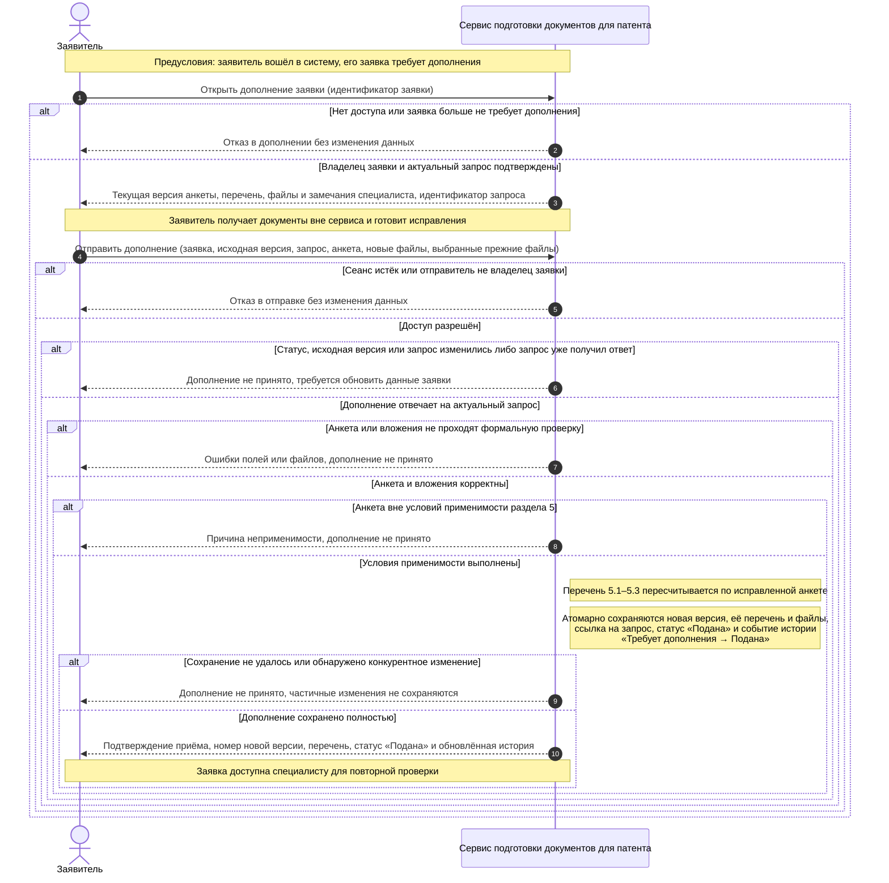

# Лабораторная работа № 3. Системная диаграмма последовательностей

## Выбранный прецедент и границы

Выбран один прецедент из [lab01](use_case.md): **«Дополнить заявку по запросу специалиста»**. Цель заявителя — исправить анкету и комплект по замечаниям и направить новую версию на повторную проверку. Подача первой заявки, работа специалиста и получение заключения — отдельные прецеденты и здесь не выполняются.

Диаграмма показывает взаимодействие внешнего участника с системой как единым целым. `Заявитель` — владелец обращения; `Сервис подготовки документов для патента` — граница приложения. Сплошные стрелки обозначают обращения заявителя, пунктирные — ответы системы; фрагменты `alt/else` — взаимоисключающие исходы. Примечания описывают условия и гарантии операций, а не вызовы внутренних классов.

Специалист создал запрос до начала сценария и проверит новую версию после него, поэтому отдельной линии участника для него нет. Получение сертификата, фотографий и ИНН происходит вне сервиса. Внешние государственные системы и SMS-сервис в этом прецеденте не вызываются.

## Предусловия и входные данные

- Заявитель зарегистрирован и вошёл по телефону и SMS-коду; вход является предусловием, а не частью выбранного прецедента.
- Заявка принадлежит заявителю и находится в состоянии «Требует дополнения». Проверка последней версии завершилась запросом с конкретными замечаниями; ответной принятой версии ещё нет.
- Система хранит предыдущую анкету, её перечень и файлы, оценки пунктов и запрос специалиста.

При открытии заявитель получает сведения своей заявки и замечания. При отправке он передаёт идентификаторы заявки, исходной версии и запроса, исправленную анкету, новые вложения и список прежних файлов, которые нужно включить в новую версию. Идентичность пользователя определяется сеансом; переданный идентификатор заявки сам по себе не даёт доступа.

Анкета содержит гражданство, признаки статуса высококвалифицированного специалиста и участия в программе переселения, наличие документа о знаниях русского языка, истории и законодательства, наличие ИНН и его номер. Выбранные прежние файлы должны принадлежать исходной версии этой же заявки. Невыбранные файлы сохраняются в старой версии, но не входят в новую.

## Основной сценарий

1. Заявитель открывает дополнение своей заявки. Система проверяет доступ и актуальность состояния, возвращает анкету, перечень, файлы и замечания.
2. Заявитель исправляет сведения, получает недостающие документы вне системы и отправляет дополнение. Подготовка документов может занимать время; открытие формы не резервирует состояние заявки.
3. При отправке система повторно проверяет сеанс, владельца, статус, исходную версию и запрос, затем корректность анкеты и файлов. Проверка включает обязательные поля, допустимые значения и форматы вложений; при заявленном наличии ИНН его номер обязателен.
4. Система проверяет применимость учебных условий и заново определяет индивидуальный перечень по исправленной анкете. Это обязательные части дополнения, соответствующие связям `include` в lab01.
5. Система принимает новую неизменяемую версию с очередным номером, сохраняет её перечень и приложения и связывает её с запросом. Повторно используемые файлы включаются в состав новой версии; прежняя версия остаётся неизменной.
6. В той же атомарной операции заявка переходит из «Требует дополнения» в «Подана», в историю добавляется событие с датой, следующим номером, инициатором-заявителем и комментарием о дополнении. Заявитель получает подтверждение и видит новую версию, перечень, статус и историю.

## Условия перечня и альтернативы

Условия ниже взяты из учебной модели раздела 5 и согласованы с [lab02](er.md). Это не утверждение об актуальном правовом регулировании.

| Условие | Поведение системы |
| --- | --- |
| Гражданство Азербайджана, Таджикистана, Узбекистана, Молдовы или Украины и отсутствие обоих особых статусов | Дополнение применимо; сохраняются три пункта 5.1–5.3 с действиями по актуальной анкете. |
| Для 5.1 нет документа о знаниях / документ имеется | Перечень предлагает получить и приложить сертификат / приложить имеющийся подтверждающий документ. |
| Пункт 5.2 | Требуются цветные фотографии 3 × 4 см. |
| Для 5.3 ИНН отсутствует / имеется | Перечень предлагает получить ИНН / указать его номер; отдельный файл ИНН не обязателен. |
| Сеанс недействителен или заявка чужая | Дополнение отклоняется без раскрытия содержимого чужой заявки; после истечения сеанса требуется повторный вход. |
| Запрос уже получил ответ, версия устарела или статус изменился | Дополнение отклоняется; заявителю предлагается обновить данные. Второй ответ на тот же запрос не создаётся. |
| Ошибки анкеты или файлов | Возвращаются конкретные ошибки. Заявитель исправляет их и повторяет отправку; принятая версия и событие истории не создаются. |
| Исправленная анкета вне условий применимости | Система объясняет причину и не принимает новую версию. Существующая заявка остаётся в прежнем состоянии. |
| Сбой сохранения или конкурентное изменение при приёме | Приём не завершается; частичная версия, отдельное событие или изменение одного лишь статуса не допускаются. При конфликте нужно обновить заявку. |

Формальная корректность не означает комплектность. Отсутствие ещё не полученного документа само по себе не блокирует отправку: как и в lab01–lab02, содержательную оценку выполняет специалист. Поэтому принятие дополнения не гарантирует заключения и не переводит заявку в «Завершена».

## Результат и согласованность данных

При успехе создана одна новая `APPLICATION_VERSION`, связанная с исходным `SUPPLEMENT_REQUEST`; для неё сохранены три `CHECKLIST_ITEM` и выбранные `DOCUMENT`. У `APPLICATION` установлен статус «Подана», а в `STATUS_EVENT` добавлен переход «Требует дополнения → Подана». Старые версии, проверки, оценки и запросы сохранены. Повторная проверка и её оценки ещё не создаются — это действия специалиста в другом прецеденте.

При отклонении или неуспешном сохранении принятой новой версии нет, прежний статус и история не меняются. Проверка актуальности выполняется также непосредственно при атомарном сохранении, чтобы два одновременных отправления не создали две ответные версии на один запрос. Если подтверждение потерялось после успешного сохранения, повторная отправка отклоняется как ответ на уже обработанный запрос; заявитель открывает заявку и видит принятую версию.

## Основания

Формат lab03 — `system_sequence.md`, ровно один блок `sequenceDiagram`, один явно названный прецедент и пояснения — установлен [README преподавателя](https://github.com/ekabardinsky/pis_2026_10/blob/master/README.md) и [labs.json](https://github.com/ekabardinsky/pis_2026_10/blob/master/labs.json), повторно прочитанными 20.10.2026. Выбор сценария, версионность и гарантии сохранения — решения проекта на основе lab01 и lab02.
